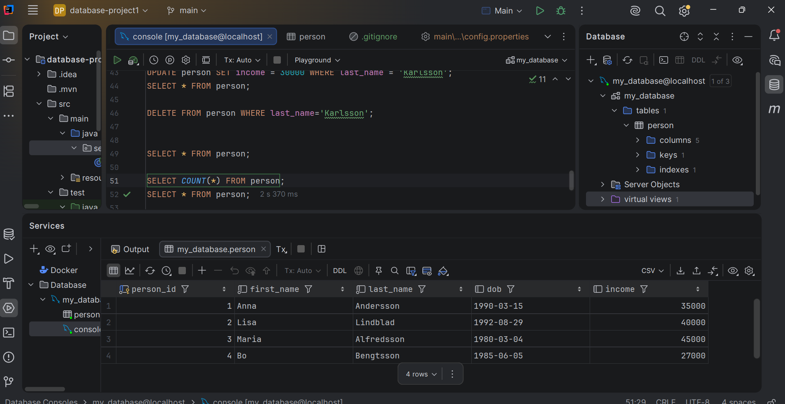
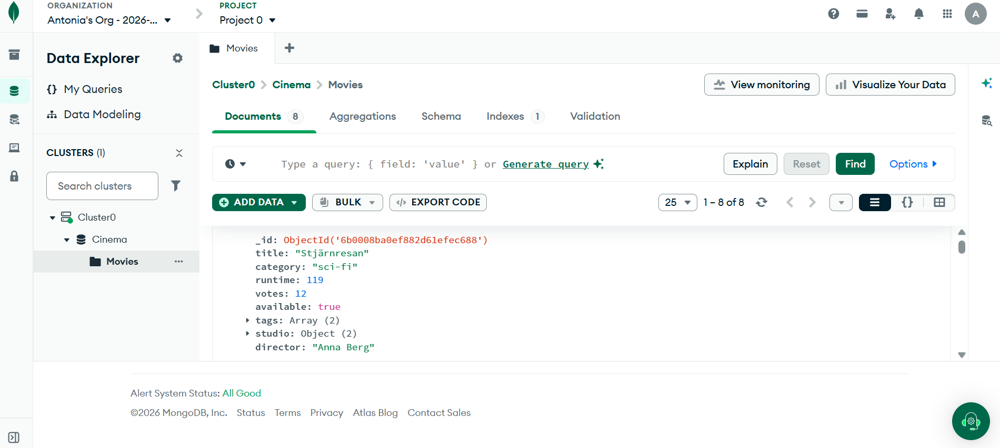
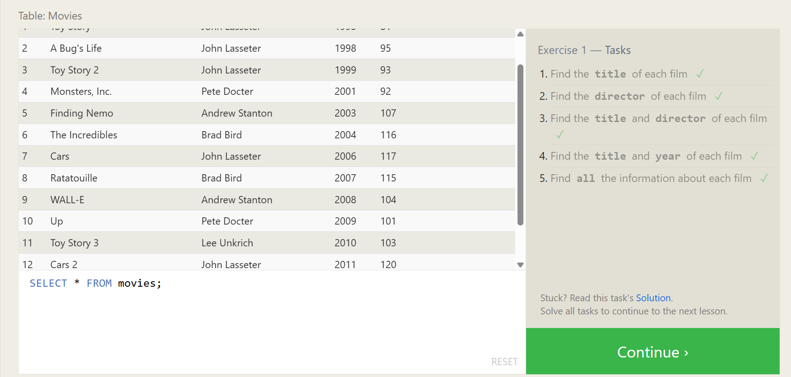
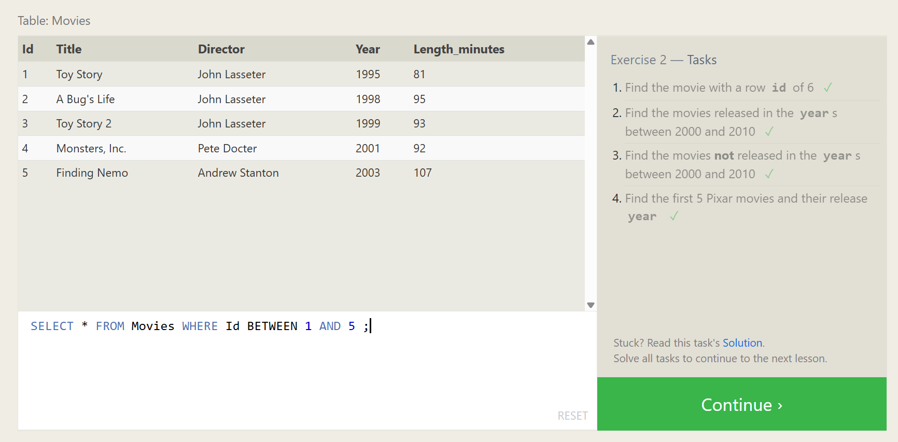

# Labb 1

## MySQL

## MongoDB

## SQL

# Frågor som ni ska svara på (G-nivå)

*Besvara frågorna med egna ord. Ge gärna exempel.*

## Databaser och verktyg

1. ***Vad är en databas, och vad kan den användas till?*** En databas är ett sätt att lagra och organisera data, som man
   vill ska vara tillgänglig under en längre tid. Den används för att enkelt kunna spara, söka efter, uppdatera och
   hämta information.
2. ***Vad används språket SQL till?*** SQL är ett språk som används för att kommunicera med databasen, som möjliggör
   hämtning av data, uppdatering, lägga till eller ta bort data.

## Tabeller och relationer

3. ***Vad är en tabell, en rad och en kolumn?***
   En tabell är den samlade strukturen för ett objekt och vad det förväntas innehålla. Medan en rad i tabellen är ett
   nytt objekt och dess värden, kolumnerna beskriver vilken typ av attribut som lagras.
4. ***Vad är en primärnyckel, och varför behövs den?*** En primärnyckeln är en unik identifierar för varje rad i en
   tabell och värdet får inte förekomma två gånger och inte heller vara NULL, alltså sakna värde. Man brukar sätta en PK
   till ett id som använder sig av AUTO INCREMENT för att säkerställa att värdet inte kommer två gånger.
5. ***Vad är en främmande nyckel?*** En främmande nyckel är en nyckel i en tabell som refererar till PK i en annan
   tabell. Som kopplar ihop tabellerna med varandra och skapar en relation mellan dessa.
6. ***Varför är det bra att lagra kunduppgifter och köp i olika tabeller?***
   Det kan vara bra då samma kund kan göra flera köp och isåfall koppla dom enskilda köpen till kundens uppgifter. Det
   möjliggör också till lättare hantering kring att ändra kundensuppgifter utan att påverka kundens tidigare eller
   pågående köp. Det minskar också datan då inte kundensuppgifter behöver lagras på nytt vid nya köp.

## NoSQL

7. ***Vad menas med NoSQL, och hur kan information organiseras i en sådan databas?***
   NoSQL är en annan typ av databas som ofta är en mer flexibel i sitt sätt att strukturera sin data. Till skillnad mot
   en relationsdatabas behöver inte data skrivas i tabeller. I MongoDb exemepelvis så sparas data i collections som
   innehåller dokument. Det är också lättare att lägga till ett nytt värde i NoSQL då du inte behöver göra om hela
   grundstrukturen för tabellen.
8. ***Ge ett exempel på när en NoSQL-databas kan vara lämplig och förklara varför.***
   Exempelvis i en webbshop där olika produkter, där oftast alla produkter har en title, pris , stock,beskrivning,
   kategori, men att det kan vara olika också om det är exempelvis ett klädesplagg så kan storlek läggas in, men är det
   en dator/telefon kan batteritid läggas in som ett attribut så alla produkter utgår från samma grundprincip men
   beroende på vad det är för typ av produkt så läggs eventuella attribut in.

## SQL – hämta data från tabellen person

*Skriv en SQL-fråga som svar på varje uppgift.*

9. ***Hämta alla kolumner för alla personer i tabellen.***

`SELECT * FROM person;`

10. ***Hämta endast förnamn och efternamn för alla personer.***

`SELECT firstname, lastname FROM person;`

11. ***Hämta förnamn, efternamn och inkomst för personer med en inkomst över 30 000.***

`SELECT firstname, lastname, income FROM person WHERE income > 30000;`

12. ***Hämta alla personer födda före den 1 januari 1990.***

`SELECT * FROM person WHERE dob < '1990-01-01';`

13. ***Hämta förnamn, efternamn och inkomst, sorterat efter inkomst från högst till lägst.***

`SELECT firstname, lastname, income FROM person ORDER BY income DESC ;`

14. ***Räkna hur många personer som finns i tabellen.***
    `SELECT COUNT(*) FROM person; `

# VG-nivå

*Dessa frågor ska besvaras med ett längre svar, minst en halv A4-sida:*

1. ***En banköverföring avbryts efter att pengarna dragits från det första kontot. Vad kan konsekvensen bli, och hur kan
   en transaktion hjälpa?***
   Om en banköverföring avbryts efter att pengarna dragits från avsändarens konto så kan detta betyda att bankens
   databas lagrar fel värden. Vilket kan resultera i förvirring hos kunderna. Att det exempelvis står hos avsändaren av
   pengarna att den har ett mindra saldo trots att pengarna inte kommit fram till mottagaren som eventuellt är till en
   kursavgift alternativ faktura. Detta ger banken allvarliga konsekvenser rent säkerhetsmässigt samt att kundernas
   förtroende för banken och dess system minskar,vilket kan leda till att banken förlorar kunder. Skulle detta ske vid
   ett x-antal banköverföringar så skulle det även kräva mycket resurser från banken för att återställa detta.

Skulle bankerna i detta fall använda sig av transaktioner vilket betyder att båda konto ändringarna sker inom samma
databastransaktion. Det säkerställer satt överföringen antingen genomomförs eller misslyckas. Om något går fel under
överföringen så kan databasen använda **ROLLBACK** för att återställa satt inga pengar dras av avsändaren och att
pengarna inte kommer fram till mottagaren. Skulle det bli en lyckad överföring om alla steg går igenom används
**COMMIT**. Detta bygger på Atomicity som är en av ACID principerna och kan enkelt förklaras som att antingen allt eller
inget.

Om man ska förklara hur en Atomicity princip fungerar och kan hjälpa bankerna så är det så att vi startar först en
transaktion där vi ska genomgå olika steg för att möjliggöra en pengaöverföring. Om alla dessa steg lyckas används
COMMIT, som bekräftar och sparar ändringarna. Men om något av dessa steg skulle misslyckas trots att resterande lyckas
så gör systemet en ROLLBACK vilket betyder att den återställer ändringarna inom transaktionen.

	`START TRANSACTION;

     UPDATE acoounts
     SET balance= balance -1000
     WHERE id=1;

      UPDATE acoounts
     SET balance= balance +1000
     WHERE id=2;

     COMMIT; `

Vid fel gör vi ROLLBACK istället.

2. ***Välj ett enkelt system, antingen en webbutik eller en chatt. Resonera om när en relationsdatabas respektive en
   NoSQL-databas kan vara lämplig. Motivera med hur informationen ska lagras och användas.***
   Om vi exemeplvis skulle välja en webbutik som ett enkelt system så skulle man till kunduppgifter och adress använda
   sig av en relationsdatabas för att dessa alltid kommer bestå av samma grund, exempelvis namn,efternamn och adress
   innehåller gatuaddressen, postnummer samt även en tabell med valda betalmetoder.En annan anledning till att använda
   relationsdatabaser till dessa tabeller är för att möjliggöra till ihopkoppling mellan tabellerna med hjälp av primary
   key och foreign key, och genom att använda dessa så möjliggör vi för databasen att samma information kring kunden
   inte behöver lagras flera gånger vid flera olika köptillfällen. Kunduppgifterna används sedan för att koppla rätt
   kund till beställningen och leveransen.

Medan själva utbutdet på webbutiken skulle använda sig av en NoSQL databas exempelvis MongoDB där produkterna kan lagras
som dokument med olika attribut som ger kunden möjlighet att söka och filtrera på produkterna utifrån exempelvis storlek
eller färg. Då olika produkter oftast har samma grundläggande information så som en title, pris , stock, beskrivning,
kategori. Men att det kan vara olika också beroende på vad det är för typ av produkt som ska lagras om det är exempelvis
ett klädesplagg så kan storlek, färg läggas till. Men är det en dator eller mobiltelefon kan batteritid och
lagringsutrymme läggas in som ett attribut. Alla produkter utgår från samma grundprincip men beroende på vad det är för
typ av produkt så läggs eventuella attribut in. Detta möjliggör också till att webbutiken kan vara mer flexibel med sina
produkter.

Jag skulle sammanfatta det så skulle en relationsdatabas vara lämplig för kunduppgifter, adress och beställningar
eftersom dessa har tydliga relationer och kan på så sätt kopplas samman via olika tabeller.En NoSQL databas hade därför
varit fördelaktigt för produkutbudet, eftersom olika produkter kan behöva olika attribut. Att välja databas beror därför
på hur informationen behöver lagras och sedan användas och utifrån om det finns tydliga relationer mellan olika tabeller
som behöver finnas för systemet.

